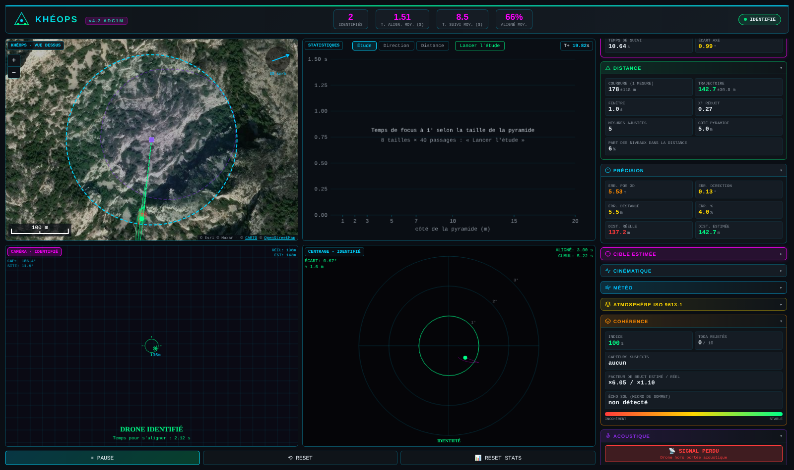
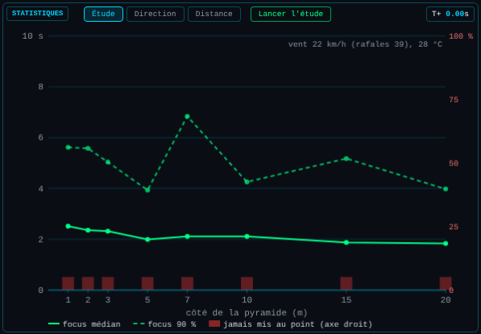

<!--
================================================================================
 Name         : Khéops - README (GitHub repository One-Page-One-Mission)
 File         : README.md
 Version      : 4.3
 Date         : 17/10/2026
 Author       : Eric PERRET
 Purpose      : overview, algorithms and design decisions of the simulator
                kheops_v43.html (French version: LISEZMOI.md)
================================================================================
-->

# 🎯 One-Page-One-Mission — Khéops v4.3

▶️ **[Launch the simulator](https://ericperret.github.io/One-Page-One-Mission/kheops_v43.html)** — the simulation starts by itself on load.

[](https://creativecommons.org/licenses/by-nc/4.0/)
[](#technology)
[](#technology)
[](kheops_v43.html)

**Passive acoustic direction-finding simulator for drones**, based on time differences of arrival (TDOA) on a 5-microphone pyramid, with an identification camera steered by acoustics only.

The simulator exists to **size the pyramid base**: it plots the *time to focus within 1°* against the pyramid side length. The real-time demonstration around that study is deliberately playful.

🇫🇷 Version française : [LISEZMOI.md](LISEZMOI.md)



---

## Contents

1. [What Khéops does](#1-what-khéops-does)
2. [Usage](#2-usage)
3. [Sizing study result](#3-sizing-study-result)
4. [Architecture: ground truth and estimator kept apart](#4-architecture-ground-truth-and-estimator-kept-apart)
5. [Physical model (ground truth)](#5-physical-model-ground-truth)
6. [Measurement chain: 1 MHz ADC and GCC-PHAT](#6-measurement-chain-1-mhz-adc-and-gcc-phat)
7. [Estimator](#7-estimator)
8. [Identification camera](#8-identification-camera)
9. [Sizing study](#9-sizing-study)
10. [Design decisions](#10-design-decisions)
11. [Known limits](#11-known-limits)
12. [Technology](#technology)
13. [History](#history)

---

## 1. What Khéops does

| Function | Method |
|---|---|
| Measurement | Time differences of arrival on all 10 microphone pairs, GCC-PHAT on a 16-bit 1 MHz ADC chain simulated sample by sample |
| Direction | Wavefront normal fitted by Levenberg-Marquardt, outliers rejected by RANSAC over the 125 spanning trees |
| Range | Wavefront curvature, inter-microphone level differences (1/r), ground-echo delay on the apex microphone — **never** the absolute level |
| Trajectory | Sliding-horizon least squares (1 s), constant-acceleration model, propagation delay built in, Huber weighting — **no recursive filter** |
| Atmosphere | Speed of sound per ISO 9613-1 / CIPM-2007 from live weather at the Khéops location |
| Wind | Logarithmic profile, exact propagation in uniform wind, actual station gusts |
| Background noise | LA90 over 30 s measured with the device microphone (if allowed), otherwise 35 dB(A) |
| Camera | Steered only by the acoustic estimate; a drone is "identified" after 3 s of continuous alignment within 1° |
| Study | Time to focus within 1° for 8 pyramid sizes × 40 reproducible passes |

Khéops is an **observation** system: there is no weapon and no fire control.

---

## 2. Usage

1. Open `kheops_v43.html` in a recent browser (Chrome, Edge, Firefox) — locally (`file://`) or through the GitHub Pages link.
2. The simulation starts automatically. The browser asks for microphone access: it is used **only** to measure background noise (LA90). If refused, background noise is 35 dB(A). If the browser suspends audio on load, measurement resumes on the first click.
3. **Click on the map**: moves Khéops there. Weather is reloaded as soon as the move exceeds 2 km.
4. **Study** tab → **Lancer l'étude** (run study): computes the sizing curve (about 2 minutes in a desktop browser).
5. **Direction** and **Distance** tabs: cumulative errors of the demonstration per range bin; tooltip on hover.
6. **PAUSE / RESET / RESET STATS** at the bottom. Right-hand panels collapse; their state is remembered by the browser.

**No setting is offered.** Everything that would be adjustable in reality comes from the weather, the microphone or the map click.

Top banner, averages over identified drones:

| Indicator | Definition |
|---|---|
| Identifiés | Number of drones identified since the last RESET STATS |
| T. align. moy. | Time from start of tracking to first alignment within 1° |
| T. suivi moy. | Tracking duration until identification |
| Aligné moy. | Share of tracking time spent aligned within 1° |

External connections (the only ones):

| Service | Use | Offline |
|---|---|---|
| Esri World Imagery | Map background (native zoom ≤ 17) | empty map, simulation unaffected |
| CARTO `dark_only_labels` | Map labels | no labels |
| open-meteo.com | Temperature, humidity, surface pressure, 10 m wind and gusts; reloaded every 15 min | standard atmosphere (20 °C, 50 %, 1013.25 hPa), no wind |

---

## 3. Sizing study result

Two independent runs of the study in the browser (8 sizes × 40 passes, same trajectory seeds; test weather: wind 22 km/h, gusts 38.5 km/h, 28 °C).

| Side (m) | Median focus (s) A / B | 90 % focus (s) A / B | Focused | ADC / model noise A / B |
|---:|:---:|:---:|:---:|:---:|
| 1 | 2.48 / 2.50 | 5.38 / 5.60 | 38/40 | ×1.05 / ×1.04 |
| 2 | 2.36 / 2.34 | 5.74 / 5.56 | 38/40 | ×1.06 / ×1.01 |
| 3 | 2.38 / 2.30 | 5.70 / 5.02 | 38/40 | ×1.06 / ×0.95 |
| 5 | 2.06 / 1.98 | 5.58 / 3.92 | 38/40 | ×1.12 / ×1.22 |
| 7 | 1.98 / 2.10 | 3.12 / 6.82 | 38/40 | ×1.04 / ×1.34 |
| 10 | 2.08 / 2.10 | 5.66 / 4.24 | 38/40 | ×1.68 / ×1.54 |
| 15 | 2.10 / 1.86 | 5.50 / 5.16 | 38/40 | ×2.15 / ×1.95 |
| 20 | 1.78 / 1.82 | 4.76 / 3.96 | 38/40 | ×4.68 / ×3.23 |



**Reading:**

- **Median**: drops from 2.5 s (1 m) to 2.0 s (5 m), then stays between 1.8 and 2.1 s up to 20 m. Same trend in both runs.
- **90th percentile**: between 3 and 7 s with no clear trend; 40 passes are not enough to stabilise this percentile (it rests on 4 passes).
- **Failures**: 2 passes out of 40 never focus, at every size and in both runs; the cause is the trajectory (identical across sizes), not the base.
- **Correlation noise**: grows with size (×1.0 at 3 m, ×1.5–1.7 at 10 m, ×3.2–4.7 at 20 m). On a large base the inter-microphone delay drifts during the 16.4 ms integration (moving source) and the correlation peak spreads: geometry improves, measurement degrades.
- **Conclusion**: most of the gain is reached at **5 m**; from 5 to 10 m focus time no longer moves and measurement noise stays moderate (≤ ×1.7); beyond 10 m the median gain (≤ 0.3 s) is paid for with correlation noise multiplied by 2 to 5. **Recommended base: 5 to 10 m side.**

---

## 4. Architecture: ground truth and estimator kept apart

The code is split into two worlds that share only the measurement:

```
GROUND TRUTH (what happens)                ESTIMATOR (what Khéops knows)
───────────────────────────                ─────────────────────────────
drone: trajectory, manoeuvres, level       station weather (mean)
true atmosphere = station + local offset   station speed of sound
true wind = mean + gusts                   station mean wind
true noise = model × unknown factors       nominal noise model
                │                                       ▲
                └──── measurement: 10 TDOA, 5 levels, ──┘
                      echo delay, SNR, segment shifts
```

The estimator **never reads** `sim.drone`, the true atmosphere, the gusts, the drone's noise factor or its source level. The true position is used only to judge camera alignment and to draw statistics. This is what makes the simulation "cheat-free".

| Quantity | Ground truth | Known to the estimator |
|---|---|---|
| Temperature, humidity, pressure | station + (−0.3 °C; +3 % RH; −0.8 hPa) | station |
| Wind | station mean + station gusts (Poisson 0.1 /s, 1 to 4 s) | mean |
| TDOA noise | model × ADC calibration × drone factor (×0.8 to ×1.25) | estimated from residuals |
| Source level | 79 dB ± 3 dB per drone, +2 dB in manoeuvre, ±1 dB common per measurement | unknown (not used) |
| Inter-mic mismatch | 0.2 dB independent per microphone | assumed σ 0.25 dB |

---

## 5. Physical model (ground truth)

### 5.1 Microphone array

Square-based pyramid of side **a**: 4 microphones on the ground at the corners, 1 at the apex above the centre, at height **h = 0.636·a** (proportions of the Great Pyramid of Khufu/Khéops). All 10 pairs (i < j) are used. Side **a** is the only sizing parameter; the demonstration uses a = 5 m.

### 5.2 Speed of sound (ISO 9613-1 / CIPM-2007)

- Saturation vapour pressure (ISO 9613-1): $p_{sat} = p_r \cdot 10^{C}$, $C = -6.8346\,(T_{01}/T)^{1.261} + 4.6151$, $T_{01} = 273.16$ K, $p_r = 101\,325$ Pa.
- Enhancement factor (CIPM-2007): $f = 1.00062 + 3.14\cdot10^{-8}\,p + 5.6\cdot10^{-7}\,t^2$.
- Water mole fraction: $x_w = \frac{RH}{100}\, f\, p_{sat} / p$; CO₂: $x_c = 420$ ppm.
- Mixture molar mass: CO₂-free dry air, CO₂ and water weighted by mole fraction (CIPM-2007 reference dry air at 400 ppm, CO₂ removed so it is not counted twice).
- Mixture γ from the $c_v$ of dry air (γ = 1.40), water vapour (1.33) and CO₂ (1.30).
- $c = \sqrt{\gamma R T / M}$. Cramer's formula (JASA 93, 1993) is computed alongside and the deviation is displayed.

### 5.3 Wind

- Logarithmic profile: $U(z) = U_{10}\,\ln(z/z_0)/\ln(10/z_0)$, $z_0 = 0.1$ m (grass, low crops).
- Wind seen by a path: exact mean of the profile between source and array heights, $\overline{\ln(z/z_0)} = [F(b)-F(a)]/(b-a)$ with $F(z) = z\ln(z/z_0) - z$.
- Exact propagation in uniform wind **w**: travel time τ satisfies $|\mathbf d - \mathbf w\tau| = c\,\tau$, hence
  $\tau = \dfrac{-\mathbf w\cdot\mathbf d + \sqrt{(\mathbf w\cdot\mathbf d)^2 + (c^2 - |\mathbf w|^2)\,|\mathbf d|^2}}{c^2 - |\mathbf w|^2}$.
- True wind: station direction and mean speed; gusts at the station gust value, triggered by a Poisson process (0.1 /s), lasting 1 to 4 s. No other variation is invented.

### 5.4 Drone

- Spawns at 142.5 m (0.95 × the 150 m bubble radius), altitude 25 to 55 m, heading towards Khéops ± 22.5°, speed 5 to 18 m/s.
- Manoeuvres: Poisson process 0.5 /s, lateral acceleration 0.5 to 2 g (random vertical component), duration 0.5 to 2 s, return to zero acceleration with τ = 0.19 s.
- 50 Hz position history over 5 s: the retarded emission time $t_e = t - \tau$ is solved iteratively on the interpolated true trajectory.

### 5.5 Acoustics

- "Consumer 600 g" source level: 79 dB at 1 m; ± 3 dB per drone (model and condition spread); + 2 dB at 2 g manoeuvre; common fluctuation ± 1 dB per measurement.
- Level received by each microphone: $L_i = L_s - 20\log_{10} r_i - \alpha_w r_i$; wind attenuation $\alpha_w$: −4 dB/100 m downwind, +5 dB/100 m upwind, at 50 km/h (proportional, zero below 5 km/h).
- Detection threshold: mean SNR of the 5 microphones ≥ 3 dB above background.
- Background noise: LA90 over 30 s, A-weighting (IEC 61672) applied to the spectrum, MEMS sensitivity −26 dBFS at 94 dB SPL, clamped to 20–90 dB(A); 35 dB(A) without microphone.
- Ground echo: flat ground, amplitude reflection coefficient ρ = 0.5 (short grass, soil). Only the apex microphone receives a distinct echo; for ground-level microphones direct and reflected sound arrive together. Delay: $\tau_{echo} = \tau(\mathbf p', \mathbf x_5) - \tau(\mathbf p, \mathbf x_5)$ with $\mathbf p' = (x, y, -z)$, i.e. about $2h\sin(\text{elevation})/c$.

### 5.6 Source signal (ADC chain)

- Tonal: blade-pass frequency 4 × 10 000 rpm / 60 = 666.7 Hz, 5 harmonics in 1/h.
- Broadband: random-phase noise, amplitude $1/\sqrt{f/500 + 1}$, band 100–8000 Hz, 0.52 s periodic table.
- Equal tonal / broadband power.

---

## 6. Measurement chain: 1 MHz ADC and GCC-PHAT

### 6.1 What a correlation actually measures

The correlation of pair (i, j) takes a **segment** of channel j and searches its lag inside the **buffer** of channel i. It therefore measures the arrival at $\mathbf x_i$ of the wavefront that reaches $\mathbf x_j$ at the centre of the segment:

$$\Delta_{ij} = \tau_i(\mathbf p_j) - \tau_j(\mathbf p_j)$$

where $\mathbf p_j$ is the emission point of the sound received at $\mathbf x_j$ at that instant. Each pair thus has its own emission point. The former "same reception instant on all microphones" convention biased the differences by a factor v/c (up to 5 % at 18 m/s); since v4.2 ground truth, estimator and calibration all use the convention above.

### 6.2 Acquisition

| Stage | Value |
|---|---|
| Sampling | 1 MHz, 16 bits, full scale set at 4 σ of the signal |
| Delays | time-varying inside the buffer (moving source: per-channel delay and rate), linear interpolation in the signal tables |
| Noise | white Gaussian over 0–500 kHz, scaled for the measured in-band SNR |
| Decimation | ×16 by block averaging → 62.5 kHz |
| Integration segment | 1024 decimated samples = 16.4 ms |
| Buffer | segment + 2 × max delay + 16, max delay = ⌈√2·a / 300 · fs⌉ + 4 |
| FFT | in-place radix-2, size = power of 2 ≥ buffer |

### 6.3 GCC-PHAT

$R_{ij}(\ell) = \mathcal F^{-1}\!\left[\dfrac{X_i\,S_j^*}{|X_i\,S_j^*|}\right]$ over the 100–8000 Hz band, $X_i$: spectrum of the buffer of i, $S_j$: spectrum of the segment of j. Peak search over valid lags (the shifted segment must stay inside the buffer), then 3-point parabolic interpolation (correction clamped to ± 0.5 sample).

### 6.4 Track-aligned segments

When a trajectory is tracked, each channel j shifts its segment by $s_j$ (integer decimated samples) so that all channels correlate **the same wavefront**: the one reaching the array centre at the measurement instant.

$s_j = t_e^{(c)} + \tau(\mathbf p_c, \mathbf x_j) - t_{rx}$

Without a track, segments are centred and the convention mismatch is added as extra uncertainty (§ 7.1).

### 6.5 Echo by cepstrum

Power cepstrum of the apex microphone buffer: $c(q) = \mathcal F^{-1}[\log|X_5|^2 - \overline{\log|X_5|^2}]$ over the useful band. Peak search between 0.3 ms and $2h/300 + 0.5$ ms; echo accepted if the peak exceeds the mean by 5 standard deviations; parabolic interpolation.

### 6.6 Real-time mode and calibration

Simulating the full ADC chain is expensive: the demonstration runs it live only when the buffer fits in 2048 decimated samples (side ≲ 1.7 m). Above that, and throughout the study, the measurement is drawn from a **noise model calibrated against the ADC chain** for the current size:

- **Model**: Cramér-Rao bound for delay estimation, $\sigma_\tau = \dfrac{1}{2\pi f_{rms}\sqrt{2\,B\,T\,\mathrm{SNR}}}$ with $f_{rms}$ = 1000 Hz, B = 7900 Hz, T = 16 ms, combined in quadrature with a 1 µs floor (synchronisation, sensor phase). Pair SNR: $10\log_{10}\dfrac{2}{10^{-S_i/10} + 10^{-S_j/10}}$. Outliers: 2 %, uniform over ± 0.3 ms.
- **Calibration** (at load time and for each study size): 80 full ADC frames, drone drawn between 30 and 100 m, elevation 10–60°, speed 5–18 m/s, segments aligned on the true geometry. Each measured difference is compared with the exact convention:

| Output | Computation |
|---|---|
| `factor` | 1.4826 × median of \|z\| (robust estimate of true σ / model σ) |
| `outlier` | share of \|z\| > 6 σ, echo excluded |
| `echoLock` | share of apex pairs locked on the echo instead of the direct sound |
| `echoDet`, `echoFactor`, `echoFalse` | cepstrum detection rate, accuracy and false peaks |

In model mode, a pair difference equals the true difference + $\sigma_\tau \times$ `factor` × drone factor × N(0,1), plus the calibrated outliers and echo locks. The estimator knows none of these factors.

---

## 7. Estimator

Rate: one measurement every 20 ms (50 Hz), fixed time step independent of the display.

### 7.1 Per frame: direction and curvature

Spherical wavefront model, in metres of path, parameters $\theta = [\mathbf q, \kappa]$ with $\mathbf q = s\,\mathbf n$ (**n**: wavefront normal towards the source, s: relative slowness) and κ = 1/R:

$$d_{ij} = s\,(f_i - f_j), \qquad f_i = \frac{\sqrt{1 - 2\kappa\,a_i + \kappa^2 b_i} - 1}{\kappa}, \quad a_i = \mathbf n\cdot\mathbf x_i,\ b_i = |\mathbf x_i|^2$$

(stable form as κ → 0, positions relative to the array centre).

1. **Plane-wave initialisation**: $d_{ij} = \mathbf q\cdot(\mathbf x_j - \mathbf x_i)$ by least squares.
2. **Levenberg-Marquardt** on the 4 parameters, with a prior residual on the expected slowness in known wind: $s_{exp} = c/(c - \mathbf w\cdot\mathbf n)$, σ = 0.01 (gusts are unknown). A step is accepted only if it lowers the cost.
3. **RANSAC**: 24 draws among the 125 spanning trees (4 independent pairs connecting the 5 microphones, enumerated with union-find); inliers within 4 σ; early exit when all 10 pairs are inliers. Final fit on inliers, then one reassignment pass. A microphone involved in at least 2 rejected pairs is flagged "suspect".
4. **Convention correction**: with a tracked trajectory, measured differences are brought back to a common wavefront by the trajectory model; otherwise the uncertainty is increased (in quadrature) by $D^2 \cdot 20 / (c \cdot 50)$, D being the largest inter-microphone distance (drone at 20 m/s and 50 m).

Outputs: direction **n** and its uncertainty (covariance projected orthogonally to **n**), curvature κ and its uncertainty, retained pairs, coherence index.

### 7.2 Trajectory: sliding-horizon least squares

**Constant-acceleration** model over the window, 9 parameters:

$$\mathbf p(t) = \mathbf p_0 + \mathbf v\,(t - t_0) + \tfrac12\mathbf a\,(t - t_0)^2$$

For every measurement in the window, the model recomputes the emission time of each wavefront (station mean wind, exact propagation) and predicts the observables directly. **Residuals**:

| Residual | Prediction | σ |
|---|---|---|
| Path difference of each retained pair | $c\,[\tau_i(\mathbf p_j) - \tau_j(\mathbf p_j)]$ with aligned segments | per-pair Cramér-Rao ⊕ 0.1 mm, × estimated noise factor |
| Inter-mic level difference (centred) | $-20\log_{10} R_i - \alpha_w R_i$, up to a constant | 0.25 dB |
| Ground-echo delay | $\tau(\mathbf p', \mathbf x_5) - \tau(\mathbf p, \mathbf x_5)$ | Cramér-Rao at echo SNR × √2, × estimated echo scale |

Level differences are centred on their mean: the unknown source level cancels and only the 1/r decay across microphones remains. It carries range information independent of the drone's power.

**Weak priors**: velocity σ = 20 m/s, acceleration σ = 15 m/s² (≤ 2 g), range 100 ± 150 m.

**Optimisation**:

- **Huber** weighting (k = 1.5 σ).
- **Levenberg-Marquardt**: up to 6 iterations, 6 λ trials per iteration, position step capped at 30 m, step accepted only if it lowers the objective.
- **Exact emission-time Jacobian**: the emission position itself depends on the parameters, since $t_e = t_{rx} - |\mathbf p(t_e) - \mathbf x|/c$. Differentiating: $d\mathbf p = \left(\mathbf I - \dfrac{\mathbf V\,\mathbf g^\top}{c + \mathbf g\cdot\mathbf V}\right)\dfrac{\partial\mathbf p}{\partial\theta}\,d\theta$, with **g** the unit vector microphone → source and **V** the velocity at emission. Each Jacobian row is therefore $\mathbf u^\top(\mathbf I - \mathbf V\mathbf g^\top/(c + \mathbf g\cdot\mathbf V))\,\partial\mathbf p/\partial\theta$, **u** being the geometric gradient of the residual.
- **Adaptive window**: 1 s by default; if the reduced χ² exceeds 4 (manoeuvre), shrink × 0.6 down to 0.3 s; regrow 0.5 s per second of consistent fit.
- **New track**: multiple starts along the measured direction at 10, 20, 40, 80, 160 and 320 m (10 iterations each); best χ² wins.
- **Check** every 2 s: multiple starts are re-run; a competing solution replaces the track if it reduces χ² by at least 20 %.
- **Coasting**: 2 s without measurement, then the track is dropped; 3.2 s of history kept.

**Estimated scale factors** (true noise is unknown):

$$k \leftarrow \exp\!\big[(1-\alpha)\ln k + \alpha \ln\!\big(k\sqrt{\operatorname{median}(\chi^2_T)}\big)\big]$$

over the last 50 χ² of the time differences, α = 0.03 (≈ 2 s at 50 Hz), clamped to [0.5; 8]. Same principle for the echo (cap 30). This factor also absorbs unmodelled errors (unknown gusts, shift quantisation).

**Outputs**: present-time position and velocity (acoustic delay compensated), range, azimuth, elevation, radial velocity, covariance (scaled by max(1, χ²)), along-line-of-sight uncertainty, share of range information contributed by levels.

---

## 8. Identification camera

- Steered **only** by the Khéops estimate; no video tracking.
- Setpoint: direction of the estimated present-time position; angular rate fed forward from the estimated velocity, plus first-order error catch-up (τ = 0.3 s):
  $\Delta\theta = \dot\theta_{ff}\,\Delta t + \varepsilon\,(1 - e^{-\Delta t/\tau})$ (ε: pointing error), saturated at 120 °/s in pan and 90 °/s in tilt.
- Tracking starts as soon as the track is valid; alignment is judged against the **true** position (great-circle error < 1°).
- **Identified** after 3 s of continuous alignment; displayed for 1.5 s, then a new drone.
- "Centring" view: camera axis / drone error, circles at 1°, 2°, 3°.

---

## 9. Sizing study

| Parameter | Value |
|---|---|
| Sides tested | 1, 2, 3, 5, 7, 10, 15, 20 m |
| Passes per size | 40, identical trajectories across sizes (mulberry32 seed: 1000 + 7919·p) |
| Maximum pass duration | 30 simulated seconds |
| Measurement | model mode, calibrated against the ADC chain for each size |
| Weather | station weather at launch time |
| Camera | same initial orientation for every size |
| **Time to focus** | start of the first alignment period within 1° held for at least 1 s, counted from start of tracking |
| Output | median, 90th percentile, passes never focused, ADC noise factor and outliers (tooltip) |

Computation runs in 25 ms slices to keep the interface responsive. Drone trajectories and gusts are reproducible; measurement noise and calibration are not (independent draws), hence slight differences between runs.

---

## 10. Design decisions

| Topic | Decision | Rationale |
|---|---|---|
| Filtering | **No recursive filter** (neither Kalman nor α-β): sliding-horizon least squares | Every estimate is explained by the measurements in the window alone; no hidden state, no process-noise tuning |
| Range | Curvature + inter-mic level differences + echo; **never the absolute level** | A drone's power is unknown (± 3 dB = factor 1.4 on range); inter-mic differences and curvature do not depend on it |
| Number of stations | **A single pyramid**, enlarged if needed | A second station would give range by triangulation, but the goal is to size an autonomous station |
| Geometry | 4 + 1 pyramid, apex at 0.636·a | The apex microphone provides elevation resolution and the ground echo; one parameter (a) to size |
| Settings | **Zero user parameters** | Weather, background noise and position come from the field; realism comes from credible variations, not sliders |
| Weather | Station assumed **on site** (small local offset) | Favourable case, accepted as such; wind is the station's, no "exotic" effects |
| Microphones | Assumed calibrated against a local source (0.2 dB) | Standard field practice |
| Measurement | Exact correlation convention, track-aligned segments | The "same reception instant" convention biased differences by v/c |
| Compute cost | Live ADC chain for small bases; ADC-calibrated model otherwise | Guaranteed real time without losing the fidelity of the real chain |
| Unknown noise | Per-drone factor (×0.8–×1.25) estimated by the estimator from its residuals | A real system does not know its noise in advance |
| Robustness | Per-frame RANSAC + Huber on the trajectory + multiple starts | Multipath outliers, echo lock, range ambiguity at start-up |
| Purpose | **Observation / identification, no weapon** | Defensive detection system; fire control removed in v3.6 |
| Map | Native canvas (Leaflet removed), click = Khéops position | No library; no device GPS |
| Reproducibility | mulberry32 for the study environment | Same trajectories for every size: paired comparison |

---

## 11. Known limits

- Flat, homogeneous ground; a single (ground) echo, no buildings or vegetation.
- Uniform wind along the path (mean of the logarithmic profile); no turbulence, no refraction by temperature gradient.
- One source at a time; no separation of several drones.
- The echo is usable only at high SNR (drone closer than about 45 m for 79 dB): it contributes to 0 to 7 % of measurements.
- Inter-mic level differences carry only a small share of range information (a few % at 5 m side, shown in the Distance panel); they are kept because they do not depend on the drone's power.
- The 5 m demonstration runs in calibrated-model mode; the full ADC chain runs live only below 1.7 m side.

---

## Technology

- **One single** HTML/CSS/JavaScript file (≈ 4,700 lines), no library, no build tool.
- Map, statistics, camera and reticle drawn with Canvas 2D.
- Radix-2 FFT and linear algebra (Gaussian elimination, inversion) written by hand.
- Fixed 20 ms physics step (at most 5 catch-up steps per frame), UI refreshed at 10 Hz.
- Works offline (without map or live weather).
- Bilingual user interface: French when the browser language is French, English otherwise.

## History

| Version | Main change |
|---|---|
| 4.3 | Bilingual interface (browser language: French or English) |
| 4.2 | Autostart; exact correlation convention; track-aligned segments; exact emission-time Jacobian; multiple starts; estimated noise factor; ground echo by cepstrum; per-size ADC calibration |
| 4.1 | Per-microphone level; level differences in the trajectory fit |
| 4.0 | Pyramid; range from curvature; sliding least-squares trajectory; Study tab |
| 3.9 | Tabbed statistics; map scale bar |
| 3.7 | Esri + CARTO map; live weather; microphone background noise; no settings left |
| 3.6 | Weapon part removed; identification camera and timers |
| 3.5 | Canvas map (Leaflet removed); ISO 9613-1 fixed; Kalman removed; ground truth isolated |
| 3.4 | 1 MHz ADC, RANSAC, wind, ISO 9613-1 |

The detail of each version is in the header block of `kheops_v43.html`.

## License

**Free for non-commercial use** — [CC BY-NC 4.0](https://creativecommons.org/licenses/by-nc/4.0/), with mandatory credit of the source and the author:

> One-Page-One-Mission — Eric PERRET — https://github.com/ericperret/One-Page-One-Mission

Any commercial use is forbidden without the author's written permission, requested by e-mail: **eperret@azs.fr**.
Full terms (French / English): [LICENSE](LICENSE).

## Author

**Eric PERRET** — [GitHub](https://github.com/ericperret)
